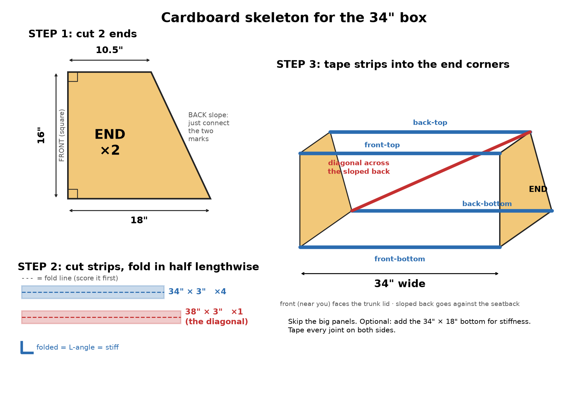

# Ported 12" sub box for a Mk4 Jetta sedan trunk (Pioneer TS-W304R, 22 Hz)

A worked design log for a **ported subwoofer enclosure in a 1999–2005 VW Jetta (Mk4/A4) sedan trunk**:
measured trunk limits, the box modelling, a parametric CAD script with cut lists, and the reasoning behind every
decision, including the ones that turned out wrong. If you have a Mk4 Jetta, a TS-W304R, or just a driver with
Qts ≈ 0.7 and a low Xmax, most of this transfers.

> **Mk4 vs Mk5:** a "2005.5" Jetta is a Mk5 with a different, bigger trunk. The measurements here are for the Mk4 sedan.



## The final box

| | |
|---|---|
| Outer size | **34" W × 15.5" H × 18" deep at the floor / 10.73" at the top** (back follows the 25.1° seatback) |
| Net volume | **82.1 L** |
| Port | 16 in² floor slot (1.75" × 9.14") × 28.8" long, straight, no bends |
| Tuning | **fb = 22 Hz** |
| Material | ¾" MDF, one brace |
| Modelled max clean SPL (1 m, half-space, no cabin gain) | 20/22/25/30/40 Hz = 102.9 / 104.4 / 106.1 / 104.8 / 106.3 dB |
| Trunk used | ~34% of the 368 L trunk |

Cut list, driver position and build notes: [box-designs.md → FINAL size](box-designs.md).
CAD: [`cad/box_v4_34x15.5in.dxf`](cad/box_v4_34x15.5in.dxf) (cut sheet), `.step`, `.FCStd`.

## Why ported (when the textbook says sealed)

The TS-W304R has Fs 28.6 Hz, Qts 0.70, Vas 77.9 L, Xmax 4.7 mm. Its EBP (Fs/Qes) ≈ 39 points to sealed, and
that's where this project started. The goal changed from "flat" to "**loud down low, fix the shape with DSP**",
and sealed loses that game:

- **A sealed box is excursion-limited, not power-limited.** In a 69 L sealed box the cone hits Xmax at ~38 W
  below 40 Hz. The amp makes 185 W. A bigger sealed box changes the *shape* by about 3 dB and adds **zero**
  maximum output, because the cone still runs out of travel first.
- **A port near fb does the work instead of the cone.** Around 22 Hz the cone barely moves and the port supplies
  the output. In this box the power needed to reach Xmax is 541 W at 22 Hz, 193 W at 25 Hz and 90 W at 28 Hz, so
  the 185 W amp is no longer the thing holding it back.
- **Net result:** roughly **+7 to +13 dB of clean output at 20–30 Hz** over the original 37 L sealed box, for the
  price of one sheet of MDF. A new driver plus amp was also evaluated: +2–5 dB for ~CAD $350–500. Not worth it.

The cost: below fb the cone unloads and excursion explodes. **A subsonic high-pass at ~20–23 Hz (≥ 24 dB/oct) is
mandatory** with this box. The GM-3500T amp used here has none, so it has to come from the DSP.

The full comparison of 3 sealed and 9 ported candidates (22/24/25/27 Hz, 40–97 L) is in
[box-designs.md](box-designs.md). The math (alignment formulas, excursion-limited power, max-SPL model) is in
[SPECS.md](SPECS.md).

## Mk4 Jetta trunk: what was measured

| Item | Value | Source |
|---|---|---|
| Between the wheel wells | **39.5"** | Tape measure (forum figure of 38⅛" is wrong or measured elsewhere) |
| Usable depth at the floor (seatback → box front) | 18" | Measured |
| Seatback profile | 18" deep at the floor, 10.5" at 16" up → 25.1° straight back; the panel is concave so a flat back clears it | Measured |
| Trunk-lid opening | **< 34"**: a 34" box will *not* go through the lid | Cardboard dummy |
| Rear-seat pass-through | Fits a box ≤ **15.5"** tall (16" only made it because cardboard flexes) | Cardboard dummy |
| Turning a box flat in the trunk | Works if the footprint diagonal < 39.5". 34 × 18" → √(34² + 18²) = 38.5" ✓. Widest that turns at 18" deep ≈ 35.2" | Geometry + dummy |
| Trunk volume | 13 ft³ (368 L) | Bentley service manual |

**Install route:** the 34" box goes in through the folded rear seats and is turned flat in the trunk. Keep the floor
behind it clear so it can come back out the same way.

Lessons that cost a cardboard box to learn: **build a cardboard dummy before cutting MDF.** It killed a 38.5" design
(no way in) and shaved ½" off the height.

## Files

| File | What it is |
|---|---|
| [PLAN.md](PLAN.md) | Goals, decisions (with dates and reasons), status checklist |
| [SPECS.md](SPECS.md) | Car, trunk, driver T/S, amp, signal chain, formulas, cabin gain. Every number is tagged with its source and confidence |
| [box-designs.md](box-designs.md) | Every candidate box with modelled results, trunk usage and cut lists |
| [box_compare.html](box_compare.html) | Interactive comparison in the browser: max SPL, 1 W response, excursion at 185 W, port air speed, port length. Open it locally, no build step |
| [max_spl.py](max_spl.py) | Lumped-element model: max clean SPL (Xmax- or amp-limited) for sealed vs vented boxes. Same model as the HTML page |
| [box_cad.py](box_cad.py) | Parametric box: net volume, port length for 22 Hz, DXF cut sheet; under FreeCAD also a 3D `.FCStd`/`.step` |
| [eq_design.py](eq_design.py), [poweramp_presets/](poweramp_presets/) | Cut-only Poweramp Equalizer presets (see the warning below) |
| [SUBWOOFER_EQ_NOTES.md](SUBWOOFER_EQ_NOTES.md) | How the EQ presets were designed |
| `subwoofer.skp` | SketchUp model of the original 37 L sealed box |

## Running the tools

`box_cad.py` needs only the Python 3 standard library; `max_spl.py` needs `numpy`; `eq_design.py` needs `numpy` and `scipy`. FreeCAD is optional (3D model only).

```sh
python3 max_spl.py                     # max-SPL table: sealed vs vented at several sizes/tunings
python3 box_cad.py 34 15.5             # dims, net volume, port length; writes cad/box_v4_34x15.5in.dxf
BOX_W=34 BOX_H=15.5 freecadcmd box_cad.py   # also writes the .FCStd and .step 3D model
python3 eq_design.py                   # re-fits and exports the Poweramp presets
```

`box_cad.py` takes the outer width and height in inches. The depth profile (18" at the floor, 25.1° back) is fixed
to this trunk; change `D_BOT` and `SLOPE` at the top of the file for a different car.

## Caveats

- **The EQ presets in `poweramp_presets/` are stale.** They were fitted to the *original sealed box* using a
  misread volume (52.7 L; the real box was 37 L) and an assumed cabin gain curve. Don't use them for the ported box.
  They need re-fitting from an in-car measurement.
- **The ported box isn't built yet**, so nothing here has been verified by measurement. After building, check fb
  (impedance dip or port-output peak) and trim the port to hit 22 Hz.
- The SPL numbers are 1 m half-space models **without cabin gain**. In the car, cabin gain adds a lot below ~50 Hz.
- Some trunk figures come from forums and are marked unverified in [SPECS.md](SPECS.md). Measure your own car.

## Signal chain (for context)

Phone (Poweramp Equalizer) → Bluetooth → stock head unit → AudioControl LC2i Pro → Pioneer GM-3500T bridged at 4 Ω
(185 W RMS, fixed 80 Hz LPF, no subsonic) → TS-W304R.
